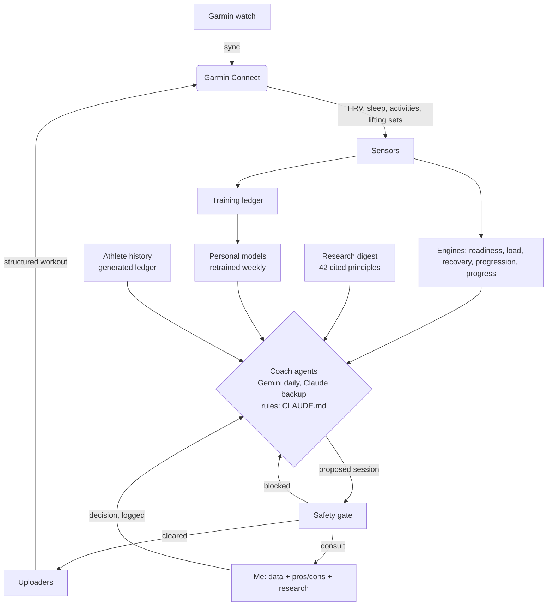

# Marathon Agent

**An AI running coach that runs itself, but never runs unchecked.** It reads my Garmin data
every morning, decides what I should train, puts the workout on my watch, and refuses to
schedule anything my body's numbers say I can't handle. When a call is genuinely a judgement
call, it stops and asks me, with the data, the trade-offs and the research.

[](https://www.python.org)
[](https://connect.garmin.com)
[](https://claude.ai/code)
[](tests/)
[](scripts/learn_weekly.py)

---

## The problem

I train for the marathon while working full time, and I lift. Every day the same questions
come up: *Is my body ready for a hard session today? How heavy should I lift without wrecking
tomorrow's run? Am I actually improving, or just getting lighter?* Garmin has the data, but it
doesn't make the decision, and a chatbot that makes the decision can confidently make it up.

I wanted a system that makes the daily decision **with an LLM's judgement, but inside hard
safety limits written in code**, and that keeps a memory of my training so it never forgets
what I've already done.

## What it does

- **Every morning at 7:00 (no laptop needed):** pulls overnight HRV, sleep, resting heart
  rate and the last 4 weeks of training from Garmin. It re-checks today's planned workout
  against the safety gate, makes the day easier if the numbers say so (never harder), and
  sends me a short summary on my phone.
- **On request:** builds running, lifting and cardio sessions and uploads them straight to my
  Garmin watch. Lifting uses Garmin's exercise library, with weights picked from my own lifting
  history.
- **Weekly and monthly:** checks the plan against training research (80/20 intensity, safe
  volume increases, single-run spikes), tracks whether I'm improving or on a plateau, and
  proposes what to change.
- **Every Sunday it learns:** three small models retrain on my own data. They learn what heat and
  hills cost me, the pace I actually run at each heart rate, and where my plans slip. They
  suggest; they never override a safety limit.

## How it works



**The core design decision: the LLM decides, the code limits.** The agent writes the plan,
but every upload goes through `sensor_pre_schedule_check.py`, a deterministic gate that
returns one of three verdicts:

| Verdict | When | What happens |
|---|---|---|
| **Cleared** | Numbers are fine | Upload. Future-dated sessions clear as *provisional* and are re-checked that morning. |
| **Blocked** | Clear-cut risk: training load spikes past a 1.5 acute:chronic ratio; HRV below my baseline *and* backed by a low weekly trend or raised resting HR; a hard session under 24 h after a long run; heavy legs within 72 h before a long run | Nothing is uploaded. The morning routine may swap in the easy alternative. |
| **Consult** | Nuanced cases: a hard session 24–48 h after a long run, heavy legs soon after one, lifting on a low-HRV day | The agent stops and brings me the data, short pros and cons, and research. My decision goes into a log, so over time we learn whether my feel or the numbers predict better. |

If Garmin data is missing, hard sessions are blocked and easy ones still clear: the gate
**fails closed**.

## Engineering highlights

- **Human-in-the-loop by design, not by accident.** Three explicit levels of autonomy:
  act alone (easy days), act only to make the day easier (morning routine), or ask (consults).
- **No hallucinated history.** The agent reads a generated ledger
  (`core_progress_tracker.py` → `brain_athlete_history.md`) before calling anything a
  milestone or setting a pace. An earlier version kept "forgetting" I'd already run two 30 km
  runs; that can't happen now.
- **Evidence-graded research instead of googling.** Training books and papers are distilled
  into `knowledge_base/PRINCIPLES.md`: 42 principles, each with its source, an evidence grade
  and the rule it drives. Key numbers were spot-checked against the original papers, and the
  ones that couldn't be confirmed are flagged. Every new lookup is logged with citations.
- **Two agents, one rulebook.** An early version had two LLM coaches that drifted apart. Now
  Gemini (in Antigravity) runs the daily loop, and Claude Code builds the bigger systems and
  takes over when the daily agent can't finish a task. Both read the same `CLAUDE.md` and pass
  the same coded gate, so neither can talk its way past a limit.
- **It learns, carefully.** A training ledger (`scripts/ledger.py`: every activity with my
  post-run effort rating, daily vitals, plan against what I actually did) feeds three models
  retrained every Sunday (`scripts/learn_weekly.py`):
  - efficiency: what heat and hills cost me;
  - pace: heart rate to pace, recent runs weighted most, moving at most 5 s/km a week, and only
    for zones I have actually run;
  - habits: where planned sessions slip.

  They are plain numpy weighted least squares and logistic regression, and every effect comes
  with a standard error, so a model says "not clear yet" instead of guessing. Models suggest;
  the gate still decides.
- **Reviews any model can rerun.** `scripts/telemetry_review.py` writes a deterministic packet
  of my telemetry and history. Claude and Gemini each review it independently, then critique
  each other's review.
- **Headless and secure.** Token-only Garmin login (`garmin_auth.py`): no password, never an
  interactive prompt, clear errors when the token needs renewing. All times are anchored to
  Philippine time; the cloud container runs on UTC, which had silently shifted "today".
- **Tested.** 20 unit tests run the gate against a simulated Garmin account, covering every
  block, consult and fail-closed path.
- **Physiology computed in software.** The Kiat Engine (`core_physiological_engine.py`)
  computes training readiness, TRIMP, aerobic decoupling, cardiac drift and EPOC from a
  Forerunner 165's lap data: metrics the watch itself doesn't provide.

## What it has found so far (my own data)

- Pace at the same heart rate (150 bpm) improved from **7:08/km** (Nov 2025) to **5:13/km**
  (Nov 2026), and VO2max rose from 51.2 to 60.6. A 10 km run at that heart rate now takes
  19 minutes less.
- The efficiency model, fitted on 166 steady runs, puts the cost of heat at about **2.5 s/km per
  +1 °C** of heat index. With heat and hills removed, I'm getting about **7 s/km faster a month**.
- The bottleneck is volume, not speed: about 43 km a week for a year. A volume-based marathon
  model (Tanda 2011) predicts about 3:32, against Garmin's VO2max-based 3:15.
- My failure mode is doing more, not less: 0 of 31 planned runs skipped. So the plan is a
  ceiling with a stated bonus cap, and the habit model never raises a plan to match an overrun.
- The watch under-reads treadmill cadence by 6–10 steps/min (a wrist-sensor artefact,
  confirmed against a biomechanics meta-analysis), so cadence trends use outdoor runs only.

## Tech

Python · numpy · [garminconnect](https://github.com/cyberjunky/python-garminconnect) (Garmin Connect
API) · Claude Code (systems, fail-safe, interactive dashboards) · Gemini in Antigravity (daily agent) ·
GitHub Actions (the no-AI morning check and the weekly retrain) · unittest · Markdown as the agents'
memory, all versioned in git.

## Repository map

| Area | Files |
|---|---|
| Rules and memory | `CLAUDE.md` (the rulebook), `brain_*.md` / `brain_current_week_plan.py` (athlete, plan, history, decisions) |
| Sensors | `sensor_fetch_garmin.py`, `sensor_pre_schedule_check.py` (the gate), `sensor_nutrition_audit.py` |
| Engines | `core_common.py`, `core_physiological_engine.py`, `core_progress_tracker.py`, `core_plan_checks.py`, `core_strength_progression.py`, `core_run_analysis.py`, `core_block_auditor.py` |
| Actuators | `actuator_workout_generator.py` (runs, bike), `actuator_session_uploader.py` (lifting, cardio, treadmill) |
| Learning | `scripts/ledger.py` (training ledger), `scripts/learn_weekly.py` (Sunday retrain), `scripts/efficiency_model.py`, `scripts/pace_model.py`, `scripts/habit_model.py`, `scripts/model_utils.py` |
| Reviews | `scripts/telemetry_review.py` (the rerunnable telemetry packet), `core_run_card.py` (the after-run card) |
| Research | `knowledge_base/PRINCIPLES.md`, `knowledge_base/RESEARCH_LOG.md`, book and paper summaries |
| Design | [`docs/ARCHITECTURE.md`](docs/ARCHITECTURE.md): full map, loops, decisions and open items |

## How it evolved

1. **ETL pipeline:** Garmin metrics into Google Sheets. Passive: it showed data, it didn't decide.
2. **Rules engine + LLM briefing:** the Kiat Engine plus a Gemini daily briefing. Useful, but
   the LLM's athlete profile went stale and two "coaches" started to disagree.
3. **Single agent with a gate:** one Claude Code agent with a written rulebook, a tested
   safety gate, consults for judgement calls, a generated training history and a research
   digest.
4. **Two agents and a learning layer (now):** Gemini runs the daily loop and Claude builds and
   backs it up, both under one rulebook. A no-AI morning check runs in GitHub Actions. A training
   ledger and three personal models retrain every Sunday.

## Running it

```bash
pip install -r requirements.txt
export GARMIN_TOKENS=...                     # saved Garmin token (see CLAUDE.md, "Garmin token")
python sensor_fetch_garmin.py                # morning audit + readiness report
python sensor_pre_schedule_check.py --type intervals --duration 50 --intensity vo2max
python core_progress_tracker.py              # writes brain_athlete_history.md
python scripts/learn_weekly.py               # retrain the personal models from the ledger, no Garmin needed
python -m unittest discover -s tests         # gate, ledger and model tests, no Garmin needed
python core_physiological_engine.py          # engine self-test, no Garmin needed
```
